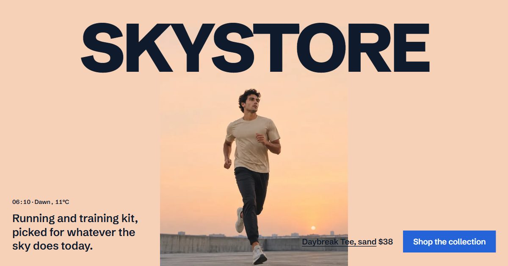

# SkyStore

Running and training kit for every sky: tees, shells, joggers, shoes and watches, picked for the weather outside.

**[Live demo](https://iliasjf.github.io/SkyStore/)** · a portfolio project. Products, prices and stock are sample data, and no real order or payment is ever taken.



## What it does

- **The day under the name.** On the home page the word SKYSTORE stays pinned while the sky passes under it: dawn, noon, wind, dusk, night. Each sky shows the piece made for it, the title takes a colour chosen for that sky, and the visitor's own hour is marked.
- **Dress for today's sky.** Reads the visitor's local weather from [Open-Meteo](https://open-meteo.com) (city taken from their time zone, no location prompt; any other city can be typed) and picks an outfit from the catalogue: a base layer, a shell when it's cold, wet, windy or dark, legs, shoes, a cap in hot sun. Without a connection, the visitor picks a sky by hand.
- **Shop** with filters kept in the URL (`/shop/?cat=shoes&max=150&sort=price-asc`), so a filtered view can be shared.
- **Product pages** with colours, sizes and live stock ("Only 2 left in XL"), sold-out sizes, a size guide, a gallery, schema.org `Product` data and "Wear it with" suggestions.
- **Search as you type** from anywhere with `/` or `Ctrl+K`, with arrow keys and Enter.
- **Cart drawer** with a free-shipping meter, quantities and a promo code (`SKY10`).
- **Checkout** with inline errors and a summary that links to each field. Payment is a demo: it accepts only Stripe's public test card `4242 4242 4242 4242`, and card details are never stored.
- **Order confirmation**, a demo **account** with order history, **saved items**, delivery and returns, and a 404.
- Prices in **US dollars or euros**, switched from the header.

## How it's built

- **Next.js 16** (App Router) with **TypeScript** and **Tailwind CSS 4**, exported as a static site for GitHub Pages under `/SkyStore/`.
- The cart, saved items, currency, orders and account live in `localStorage` through one small store read with `useSyncExternalStore` (`src/lib/store.ts`), so open tabs stay in sync.
- The weather-to-outfit rules are plain functions in `src/lib/sky.ts`; the catalogue is in `src/lib/catalog.ts`.
- Motion: sticky scroll scenes (the pinned title, a shoe seen at three distances, the delivery terms stepping over one photo), staggered entrances, a cursor-following photo on the product list, and slow drifts on the sky photos. Everything that moves stops under `prefers-reduced-motion`.
- Accessible by default: real buttons and labels, a skip link, visible focus, native `<dialog>` for the cart, search and size guide, and every page usable by keyboard.

## Run it

```bash
npm install
npm run dev     # http://localhost:3000/SkyStore/
npm run build   # static site in out/
```

`npm run build` also runs `scripts/flatten-segments.mjs`. Next.js 16 writes each page's prefetch file in nested folders, while the browser asks for one dotted file name; the script copies each file to the name that's requested, so links prefetch correctly on a static host.

## Credits

- Product and campaign photographs were generated for this project with Figma AI. No real brand's products appear.
- Cloud time-lapse: ["Cumulus"](https://commons.wikimedia.org/wiki/File:Cumulus.ogv), CC BY 2.5, via Wikimedia Commons.
- Weather data: [Open-Meteo](https://open-meteo.com), CC BY 4.0.
- Type: Schibsted Grotesk.

SkyStore started in 2022 as a static HTML template and was rebuilt as a working store twice since; the earlier versions are in the Git history.

## License

[MIT](LICENSE)
